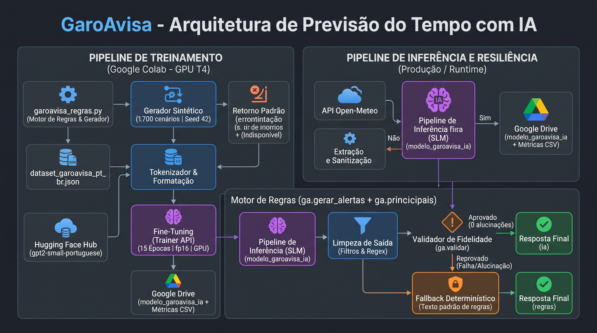

# GaroAvisa IA

Módulo de Inteligência Artificial do **GaroAvisa**, solução CitizenTech da Global Solution 2026/2.
Disruptive Architectures: IoT, IoB & Generative IA - FIAP - Análise e Desenvolvimento de Sistemas

## Integrantes

| RM | Nome | Turma |
| -------- | ----------------------------- | ------ |
| RM563000 | Enzo Vieira Bernardini | 2TDSPI |
| RM561713 | Eduardo Batista Locaspi | 2TDSPI |
| RM565698 | Liana Lyumi Morisita Fujisima | 2TDSPI |
| RM561833 | Victor Alves Lopes | 2TDSPI |

---

## Sobre o projeto

### O problema

A previsão do tempo chega para a maioria das pessoas como um conjunto de números: máxima de 34 °C, índice UV 11, rajadas de 62 km/h. Poucas pessoas sabem o que fazer com esses valores, e ninguém percebe sozinho quando a previsão de um compromisso (um jogo, um dia de praia) muda muito.

### A solução

O **GaroAvisa** acompanha o clima dos lugares que importam para o cidadão (casa, trabalho, escola) e dos compromissos dele. Este repositório é o **módulo de IA**: um modelo de linguagem em português, ajustado com Fine-Tuning, que transforma os números da previsão em um texto simples, com alertas e uma dica do que fazer.

### Relação com o tema da Global Solution

O tema é CitizenTech, e o GaroAvisa se encaixa na área **Clima e emergências** (alertas à população sobre chuva forte, ondas de calor e outros extremos). A IA ajuda o cidadão a entender a previsão e a se preparar, e se relaciona com os ODS:

- **13**: Ação contra a mudança global do clima
- **11**: Cidades e comunidades sustentáveis
- **3**: Saúde e bem-estar (alertas de calor, UV e ar seco)

---

## Funcionalidade de IA

**Público:** o cidadão que usa o app para acompanhar o clima dos seus locais e compromissos, principalmente quem mora em áreas sujeitas a chuva forte, calor e ar seco e tem dificuldade de interpretar dados meteorológicos.

**O que a IA faz** (o mesmo modelo faz duas tarefas):

| Tarefa | Entrada | Saída |
| --- | --- | --- |
| Previsão explicada do dia | máxima, mínima, UV, chuva, vento, umidade e os alertas calculados pelas regras | texto em português com os alertas e a dica do dia |
| Aviso de mudança | compromisso, previsão antes, previsão agora e o que mudou | texto avisando que a previsão do compromisso mudou (ou que não mudou) e o que fazer |

**Exemplo de saída (Tatuapé, previsão real da Open-Meteo):**

> Hoje a máxima será de 24°C e a mínima de 18°C. Radiação UV em nível médio, com índice máximo de 9. Chuva prevista, nível baixo: 100% de chance e até 2 mm/h. Dica do dia: use protetor solar e óculos e evite o sol das 10h às 16h.

**Exemplo de aviso de mudança:**

> Atenção, o clima de Dia de praia mudou: a chance de chuva subiu de 20% para 78% e a máxima caiu de 30°C para 26°C. Leve guarda-chuva ou reveja o plano.

---

## Arquitetura do Projeto



### O que é real e o que é simulado

| Aspecto | Nesta entrega | Na solução completa |
| --- | --- | --- |
| Previsão do tempo | Real, da Open-Meteo, para os 5 endereços do banco | A API busca e repassa à IA |
| Dataset de treino | Sintético (valores sorteados e textos montados pelas regras) | Seria ampliado com textos revisados por pessoas |
| Previsão "antes" do aviso de mudança | Simulada (a Open-Meteo não guarda previsões antigas) | A API guarda a previsão e compara depois |
| Banco de dados | Não usado pela IA; só os endereços de teste foram copiados do script SQL | A API lê e grava no Oracle |
| Chamada da IA pela API | Representada pelo notebook | A API chama a função `explicar` |

---

## Modelos e tecnologias

| Tecnologia | Uso |
| --- | --- |
| Python, Google Colab (GPU T4) e Jupyter | Ambiente de execução, igual ao das aulas |
| `transformers`, `datasets`, `accelerate` | Carregar o modelo, tokenizar e treinar |
| `pierreguillou/gpt2-small-portuguese` | Modelo base em português (o mesmo da aula) |
| `pandas`, `matplotlib` | Tabelas e gráficos |
| `requests` e Open-Meteo | Previsão real (gratuita, sem chave) |

---

## Justificativas técnicas

- **IA generativa com modelo local.** A funcionalidade é gerar texto. Um modelo pequeno, treinado por nós, roda sem custo, sem chave de API e sem enviar dados para terceiros.
- **Aprofundamento escolhido: Deep Learning (Fine-Tuning).** Partimos de um modelo que já sabe português e o ajustamos com 1.530 exemplos do nosso domínio, como na aula de GPT-2. Não usamos RAG nem Machine Learning clássico, porque os dados já chegam estruturados, não há uma base de documentos para consultar e o texto segue padrões fixos.
- **As regras decidem e a IA escreve.** Quais alertas existem e o que mudou em um compromisso é calculado pelas regras, que são determinísticas e fáceis de auditar, e o resultado vai escrito na pergunta. Testamos deixar o modelo decidir se a variação passava do limite e ele errou muito (veja a evolução na seção de avaliação).
- **Marcador `[FIM]`.** Na aula, o texto de treino não tinha marcador de fim, e o nosso modelo não aprendia a parar de escrever. Acrescentamos `[FIM]` ao fim de cada resposta e cortamos o texto nele.
- **Validador e texto por regra.** Um modelo pequeno pode errar números ou esquecer um alerta. O validador confere cada resposta e, se ela estiver errada, o cidadão recebe o texto por regra. Assim ele sempre recebe um texto correto.
- **`max_length=256`** (na aula era 128). As respostas com 3 alertas são maiores. O notebook confere que o maior exemplo tem 166 tokens e que nenhum é cortado.
- **Dataset sintético.** Não existe uma base pública de previsões com textos explicativos. Gerar os exemplos pelas regras garante que o texto de treino seja sempre coerente com os números.

### Regras de alerta

O disparo de cada alerta vem do guia da Open-Meteo e a gravidade vem das faixas do banco do GaroAvisa (`fn_nivel_risco`).

| Alerta | Dispara quando | Gravidade |
| --- | --- | --- |
| CHUVA | probabilidade >= 60% | pelo mm/h máximo: >= 5 média, >= 10 alta |
| CALOR | máxima >= 30 °C | >= 30 média, >= 35 alta |
| UV | índice máximo >= 8 | >= 8 média, >= 11 alta |
| VENTO | rajada >= 50 km/h | >= 50 média, >= 75 alta |
| FRIO | mínima <= 14 °C | baixa |
| AMPLITUDE | máxima menos mínima >= 10 | baixa |
| UMIDADE | umidade mínima < 30% | baixa |
| SECA | menos de 1 mm em 5 ou mais dos próximos 7 dias | baixa |
| Mudança de previsão | máxima mudou 4 °C ou mais (regra do banco) ou chance de chuva mudou 30 pontos ou mais | |

A regra de mudança de chuva (30 pontos) foi escolha do grupo, porque o guia só define a de temperatura. Quando há mais de 3 alertas, a IA explica os 3 mais graves.

---

## Dados e preparação

### Fontes

- **Previsão:** [Open-Meteo](https://open-meteo.com/).
  - Campos diários: `temperature_2m_max`, `temperature_2m_min`, `uv_index_max`, `precipitation_sum`, `precipitation_probability_max` e `wind_gusts_10m_max`.
  - Campos por hora: `relative_humidity_2m` e `precipitation`.
- **Regras, dicas e tipos de alerta:** guia da Open-Meteo e script SQL do grupo (`garoavisa-global.sql`).
- **Endereços de teste:** os 5 de `T_GA_ENDERECO` (Tatuapé, Bela Vista, Guarulhos, Copacabana e Gonzaga, em Santos).

### Preparação

1. `extrair_dias` transforma o JSON da Open-Meteo em um dicionário por dia. Dos dados por hora, pega a umidade mínima e a chuva máxima em mm/h de cada dia, e marca "semana seca" para o dia de hoje.
2. `gerar_dataset` sorteia 1.700 exemplos (70% "dia" e 30% "mudança", semente 42), com 60% de valores realistas e 40% uniformes para cobrir casos de borda. Cada tipo de alerta aparece mais de 100 vezes, e os textos têm duas variações de frase por alerta.
3. O dataset segue o formato da aula (`question` e `answer`) e guarda também `tarefa` e `dados`, que são usados na avaliação.
4. A divisão é de 90% para treino (1.530 exemplos) e 10% para teste (170). O texto de treino fica assim: `Pergunta: ... Resposta: ... [FIM]`.

Dataset pronto: [`dados/dataset_garoavisa_pt_br.json`](dados/dataset_garoavisa_pt_br.json)

---

## Estrutura do repositório

```
garoavisa-ia/
├── README.md
├── requirements.txt
├── .gitignore
├── src/
│   └── garoavisa_regras.py      regras de alerta, dataset, validador e texto por regra
├── dados/
│   └── dataset_garoavisa_pt_br.json
├── notebooks/
│   └── garoavisa_ia.ipynb       passo a passo: dados, Fine-Tuning, uso e avaliação
└── avaliacao/
    ├── perplexidade.csv
    ├── fidelidade.csv
    └── casos_de_teste.csv
```

---

## Como executar

### Pré-requisitos

- Conta Google, com acesso ao Google Drive e ao Google Colab.
- Internet (para baixar o modelo base e consultar a Open-Meteo).

### Passo a passo

1. No Google Drive, crie a pasta `MyDrive/GaroAvisa_Colab` e envie para ela o arquivo `src/garoavisa_regras.py` (se já existir um com esse nome, substitua).
2. No Google Colab, abra o notebook `notebooks/garoavisa_ia.ipynb` (Arquivo, Abrir notebook, GitHub, ou faça o upload do arquivo).
3. Em **Ambiente de execução > Alterar tipo de ambiente de execução**, escolha **GPU T4**.
4. Execute os Passos 1 a 14 em ordem. No Passo 2, o Colab pede autorização para acessar o Drive.
5. O treino leva cerca de 13 minutos, e o notebook inteiro usa em torno de 20 minutos de GPU.

O notebook entregue já está salvo com as saídas, então é possível ver os resultados sem executar nada.

### O que cada passo faz

| Passo | O que faz |
| --- | --- |
| 1 | Instala as bibliotecas |
| 2 | Conecta o Google Drive e importa o `garoavisa_regras.py` |
| 3 | Gera o dataset sintético com 1.700 exemplos |
| 4 | Busca a previsão real dos 5 endereços na Open-Meteo e calcula os alertas |
| 5 | Divide treino e teste e tokeniza os textos |
| 6 | Carrega o modelo base e mede o loss antes do treino |
| 7 | Faz o Fine-Tuning e salva o modelo no Drive |
| 8 | Mostra a curva de loss e compara antes e depois (`perplexidade.csv`) |
| 9 | Carrega o modelo treinado e cria o gerador de texto |
| 10 | Mostra o fluxo completo com a previsão real do dia |
| 11 | Mostra o aviso de mudança de previsão de um compromisso |
| 12 | Mede a fidelidade em 100 exemplos de teste (`fidelidade.csv`) |
| 13 | Roda os 16 casos de teste (`casos_de_teste.csv`) |
| 14 | Força um modelo ruim para mostrar o texto por regra |

O notebook salva no Drive o modelo (`modelo_garoavisa_ia/`), o dataset e os arquivos `perplexidade.csv`, `fidelidade.csv` e `casos_de_teste.csv`. Cópias dos CSVs ficam em `avaliacao/`.

**Modelo treinado:** (https://drive.google.com/drive/folders/1syq7PnCArQ_KUXuP9SBhJIjyD-JLT2Ik?usp=sharing)

## Avaliação dos resultados

O notebook mede o modelo de três formas, todas em dados que não foram usados no treino.

### 1. Perplexidade (loss no conjunto de teste)

A perplexidade indica o quanto o modelo "estranha" o texto correto. Quanto mais perto de 1, melhor.

| Versão | Modelo | Loss de teste | Perplexidade |
| --- | --- | --- | --- |
| v2 | Base (sem treino) | 4,428 | 83,8 |
| v2 | Fine-tuned | 0,243 | 1,275 |
| v3 (final) | Base (sem treino) | 4,467 | 87,1 |
| v3 (final) | Fine-tuned | 0,234 | 1,264 |

Na curva de loss do treino (Passo 8), as curvas de treino e de teste caem juntas e ficam muito próximas, o que indica que o modelo não decorou os exemplos de treino (overfitting).

### 2. Fidelidade do texto

Em 100 exemplos de teste (64 de "dia" e 36 de "mudança"), o validador confere:

- se não há números inventados;
- se todos os alertas principais foram explicados;
- se há dica do dia (ou aviso de que não há alertas);
- se cada frase é uma das frases esperadas para aqueles dados;
- se a quantidade de frases está certa;
- na mudança, se o compromisso foi citado e se o texto diz corretamente que mudou ou que não mudou.

A fidelidade é a porcentagem de respostas aprovadas **sem** precisar do texto por regra.

| Versão | O que mudou | Geral | Dia | Mudança |
| --- | --- | --- | --- | --- |
| Base | modelo sem treino | 0,0% | 0,0% | 0,0% |
| v1 | Fine-Tuning como na aula | 41,0% | 64,1% | 0,0% |
| v2 | marcador `[FIM]` e validação por frase | 82,0% | 100,0% | 50,0% |
| v3 (final) | decisão da mudança escrita na pergunta | 100,0% | 100,0% | 100,0% |

**Como o resultado evoluiu:**

- **v1:** o modelo não aprendeu a parar e continuava escrevendo frases da outra tarefa (a v1 foi medida com uma limpeza de repetições, sem o marcador).
- **v2:** com o `[FIM]`, o "dia" chegou a 100%, porque as regras já entregavam os alertas na pergunta. Na "mudança", o modelo precisava decidir sozinho se a diferença passava do limite e acertava pouco: em 9 dos 26 casos em que a previsão mudou de fato, ele disse que não mudou, e em 3 casos sem mudança ele avisou mudança.
- **v3:** as regras passaram a escrever na pergunta o que mudou, e o modelo só redige o aviso. A fidelidade da "mudança" foi para 100%.

### 3. Casos de teste

São 16 casos: valores típicos, situações do banco (calor e UV, chuva forte, vento), valores exatamente no limite das regras e logo abaixo, dia com mais de 3 alertas, avisos de mudança e falhas com dado ausente. O resultado está em [`avaliacao/casos_de_teste.csv`](avaliacao/casos_de_teste.csv), com a coluna `origem`:

| origem | Quantidade | Significado |
| --- | --- | --- |
| `ia` | 13 | o texto da IA passou no validador |
| `regra` | 0 | o validador reprovou e o texto por regra foi usado |
| `indisponivel` | 3 | faltou dado e o sistema respondeu "Previsão indisponível" |

As 3 respostas `indisponivel` são os casos de falha de dado ausente (UV ausente, nenhum dado e chuva atual ausente) e mostram o comportamento esperado: o sistema não inventa nenhum valor.

O Passo 14 força dois "modelos ruins" de propósito, um que inventa um número (99 °C) e outro que não escreve nada. Nos dois, o validador reprova a resposta, lista os motivos e o cidadão recebe o texto por regra.

### Análise

O Fine-Tuning reduziu a perplexidade de 87,1 para 1,26, e a fidelidade chegou a 100% nas duas tarefas, contra 0% do modelo base. A avaliação por fidelidade mostrou onde o modelo errava (a decisão de mudança), o que a perplexidade sozinha não mostrava.

O 100% mede a fidelidade ao **formato dos nossos textos**. O dataset é sintético e o conjunto de teste vem do mesmo tipo de texto, então o resultado não quer dizer que o modelo funcionaria com qualquer previsão ou pergunta. Por isso o validador e o texto por regra continuam no fluxo.

---

## Limitações e uso responsável

### Limitações da IA

- O modelo é pequeno (GPT-2) e pode errar números, esquecer alertas ou escrever frases estranhas. Por isso existem o validador e o texto por regra.
- O dataset é sintético: o modelo aprende o estilo dos nossos textos e não tem conhecimento meteorológico próprio. Na prática, ele escolhe e combina as frases dos nossos modelos de texto, então a variação é pequena. Perguntas fora do formato, fora do tema ou em outro idioma não são confiáveis.
- A IA só explica o que as regras calcularam. Ela não prevê o tempo, e a qualidade do texto depende da previsão da Open-Meteo, que também é uma estimativa.
- O validador confere números, palavras-chave e frases, mas não avalia se o texto soa bem.
- Só português. Sem horário de início da chuva. O aviso de mudança considera um dia por compromisso.
- A previsão "antes" do aviso de mudança é simulada nesta entrega.
- Os alertas são estimativas e não substituem os avisos oficiais da Defesa Civil (telefone 199; alertas por SMS no 40199).

### Dados pessoais e credenciais

- A IA recebe apenas dados meteorológicos. Nome, e-mail, senha e demais dados de usuários nunca entram no modelo.
- O repositório não contém credenciais. O `.gitignore` bloqueia `.env` e os pesos do modelo.

---

## Referências

- [Open-Meteo: Weather Forecast API](https://open-meteo.com/en/docs)
- [Hugging Face: `pierreguillou/gpt2-small-portuguese`](https://huggingface.co/pierreguillou/gpt2-small-portuguese)

